# Lintel

Model your home in plan, elevation and 3D, so you can plan changes before you make them.
Single-family houses, any number of levels, on flat or sloping ground.
Built in Rust with [Rune](https://github.com/anomalyco/rune).

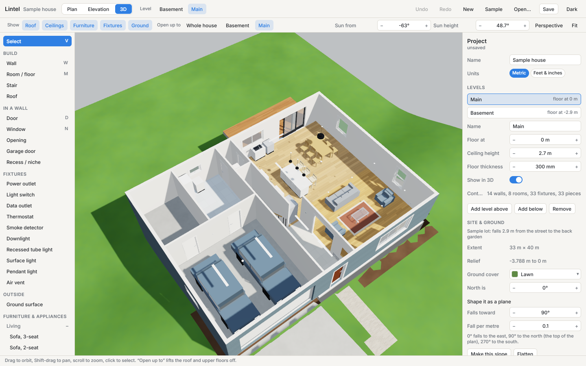

| | |
| --- | --- |
| 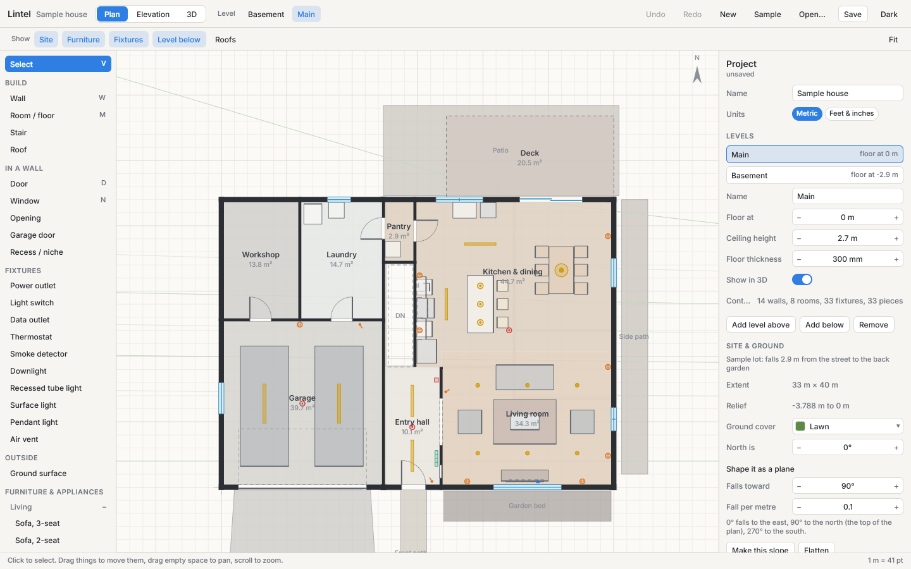 | 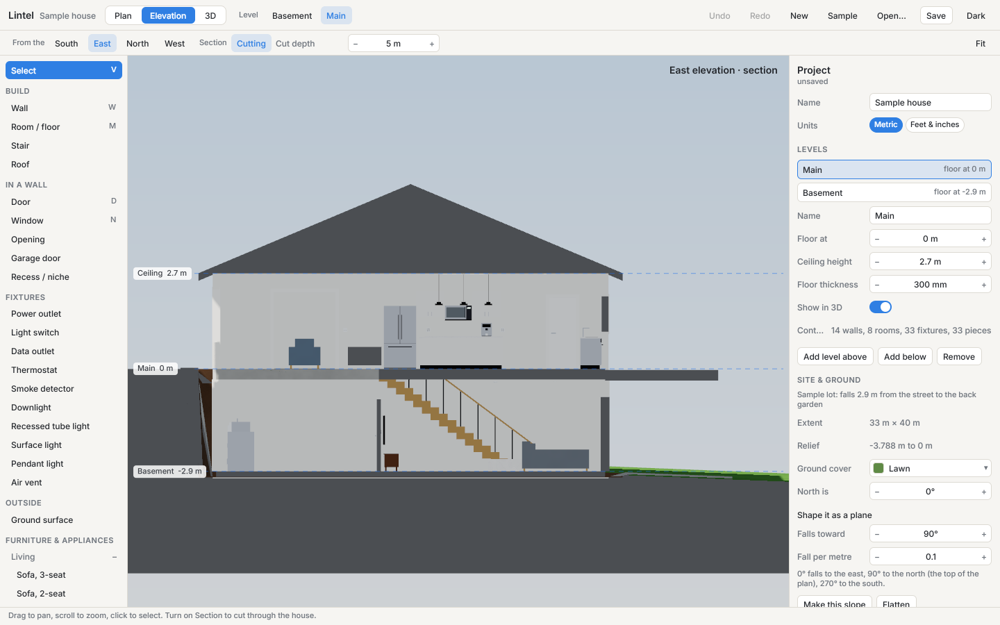 |
| 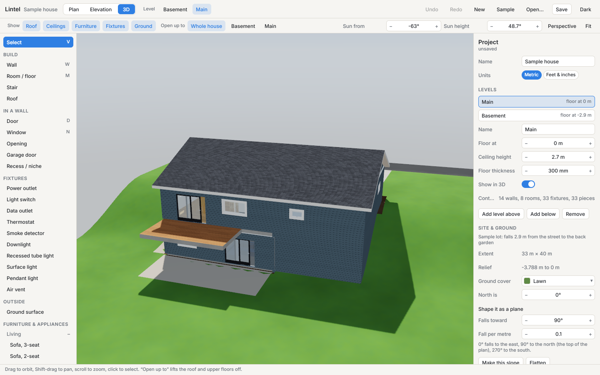 | 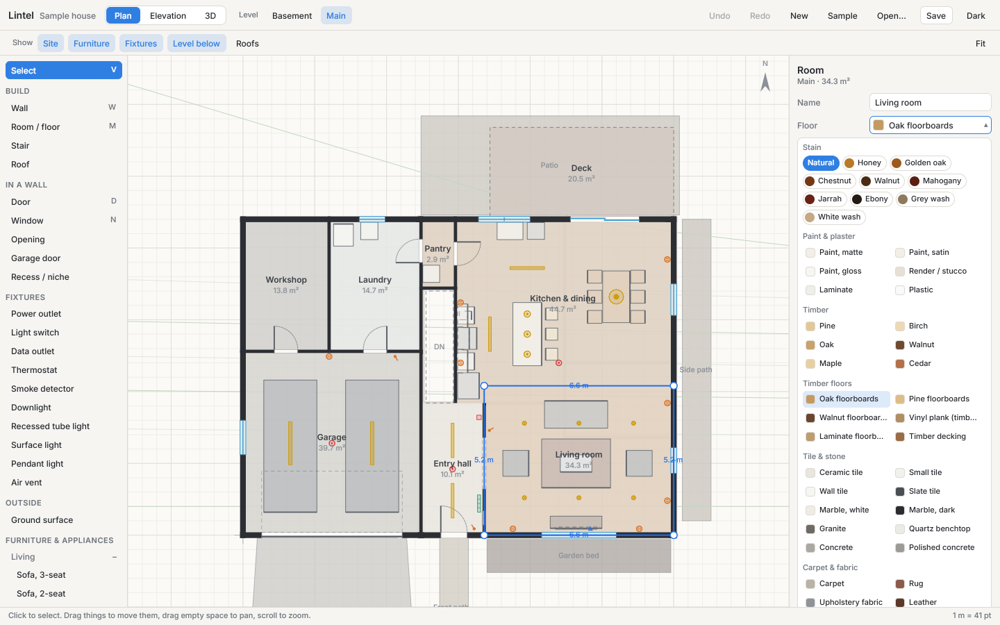 |
| 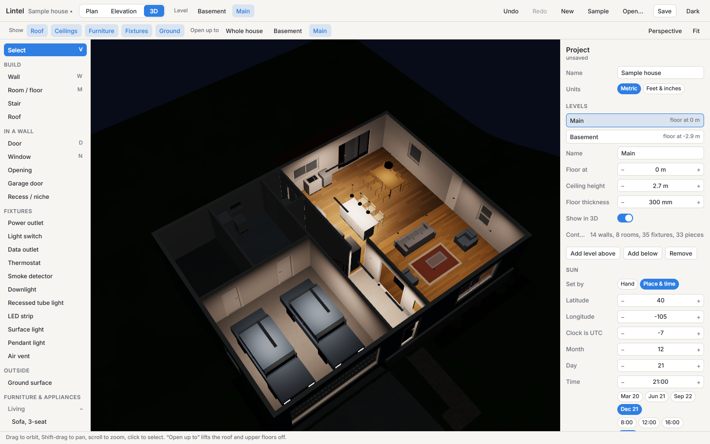 | 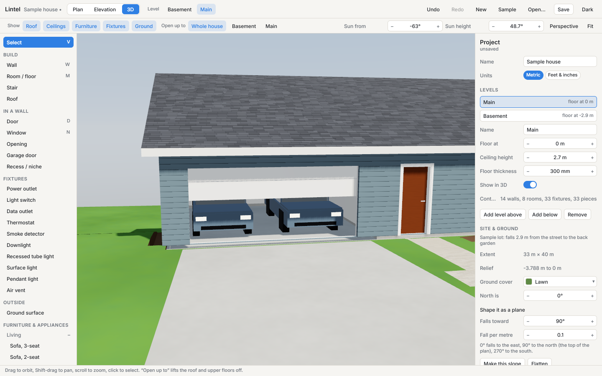 |
| 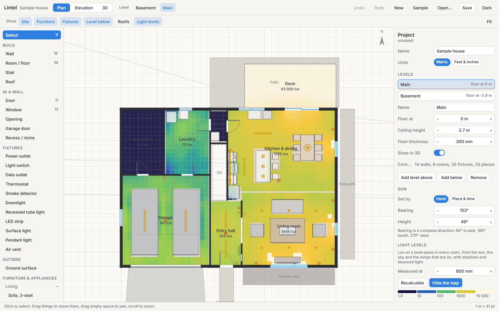 | 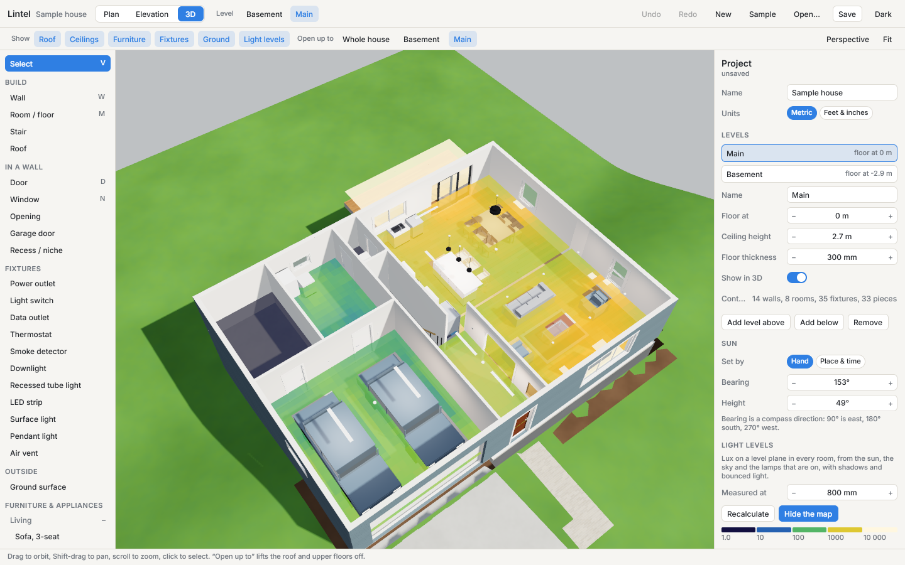 |

## What it models

- **Levels** with their own floor height, ceiling height and floor thickness. A walk-out
  basement is a level with a negative floor height on ground that falls away.
- **Walls** with thickness, height (full or partial) and a finish on each face, plus
  finishes over part of a face's height: tiling to a dado, a splashback, wainscoting.
  A wall can also carry its build-up (lining, studs, insulation, cavity, brick, cladding),
  which sets its thickness and shows on the plan and on top of the walls with the roof off.
- **Doors** (hinged, double, sliding, pocket, bifold) with frames, architraves and glazing;
  **garage doors** (sectional, roller, tilt-up) at any width, drawn at any amount open;
  **windows** (fixed, casement, awning, double-hung, sliding, louvre); cased **openings**;
  **recesses**.
- **Rooms**: floor outlines of any shape with their own floor finish, ceiling finish, ceiling
  height and floor offset. Where there is no room there is no floor, which is how a stairwell
  stays open.
  A room can have a skirting board and a cornice, which stop at doorways.
  Ceilings can be flat, sloped or vaulted, and the walls fill in up to them; bulkheads and
  exposed beams hang from the ceiling wherever it is.
- **Stairs**, **roofs** (gable, hip, shed, flat).
- **Fixtures**: power and data outlets, light switches, thermostats, smoke detectors,
  downlights, recessed tube lights, LED strips in diffuser channels, surface and pendant
  lights, air vents.
- **Light**: each light has a source (LED, incandescent, halogen, fluorescent), lumens, colour
  temperature and a dimmer, and lights its room in the 3D view. A switch knows the lights it
  controls: flick it and they go on or off. The sun is set by hand, or follows the site's
  latitude and longitude, the date and the time, down to night.
- **Furniture and appliances**: a starter catalogue of 43 resizable pieces.
- **Outside**: fences and gates that follow the ground, retaining walls, glass balustrades,
  trees and shrubs (which shade the light calculation), and raised decks that get posts down
  to the ground. Outdoor steps are a stair on the lower level.
- **Ground**: a height grid you can shape as a plane, or fetch from a public elevation
  service by latitude and longitude, plus draped surfaces (driveway, paths, patio).
- **Materials**: about 55 procedural surfaces. Paints take any colour, timbers keep their own
  colour and take a stain, and stone, brick and concrete are the colour they are.

## Light levels

**Light levels → Calculate** works out the illuminance in lux on a level plane in every room
(0.8 m up by default): sunlight and skylight through the windows, the lamps that are on,
shadows, and light bounced off walls, floors and ceilings. The map shows on the plan and in
3D, each room gets an average, and the status line reads the level under the pointer.

Give a room a target (150, 300, 500 lux or your own) and it is flagged when the calculation
falls short. The sky can be clear or overcast: a cloudy day has no direct sun and is the
usual worst case for daylight.

It is a planning estimate, not a photometric report. Fittings are ideal points with a simple
beam shape (no IES files), the clear sky is uniform and the overcast one is the CIE standard, glass passes 80 %, and surfaces
reflect diffusely by their colour. The tests check it against the inverse-square law, the
daylight on open ground, and the energy balance of bounced light in a closed room.

## Download

Builds of the latest commit for Linux, macOS (Apple silicon) and Windows are on the
[latest pre-release](https://github.com/bendechrai/lintel/releases/tag/latest). They are
unsigned. On macOS, clear the quarantine flag first: `xattr -d com.apple.quarantine lintel`.
On Windows, choose "More info" then "Run anyway" when SmartScreen asks.

Or try it in a browser with WebGPU: <https://bendechrai.github.io/lintel/app/>. The site's
front page is <https://bendechrai.github.io/lintel/>.

## Run it from source

```bash
cargo run --release
```

```bash
cargo run --release -- my-house.lintel.json
```

Linux needs `libxkbcommon-dev libwayland-dev` to build and `libxkbcommon-x11-0` to open a
window. It opens on a sample house; **New** starts empty. Projects are pretty-printed JSON.

| | |
| --- | --- |
| `1` `2` `3` | Plan, elevation, 3D |
| `V` `W` `M` `D` `N` | Select, wall, room, door, window |
| Drag | Move things; pan on empty space (plan); orbit (3D, Shift to pan) |
| Scroll | Zoom |
| Double-click an edge | Add a corner to the selected room or ground surface |
| `R`, arrows, Delete | Turn, nudge, delete the selection |
| `Ctrl/⌘ Z`, `Shift Z`, `S`, `O`, `D` | Undo, redo, save, open, duplicate |

Numbers in the inspector can be typed (`2.4`, `2400mm`, `7' 10 1/2"`), stepped, or scrubbed
by dragging sideways.

## Ground from an elevation service

In the project panel, enter a latitude and longitude and press **Fetch ground heights**.
Lintel sends a grid of coordinates around that point to
[Open Topo Data](https://www.opentopodata.org) and, failing that,
[Open-Meteo](https://open-meteo.com/en/docs/elevation-api). Nothing else is sent. These
models are 10 to 90 m coarse: they give a lot's overall fall, not its grading.

## Develop

```bash
cargo test --release
```

`tests/editing.rs` drives the real view with presses, drags and keys. Any view renders
headless (on Linux without a GPU, install `mesa-vulkan-drivers` and set
`VK_ICD_FILENAMES=/usr/share/vulkan/icd.d/lvp_icd.json`):

```bash
target/release/lintel --snap out.png --scene dollhouse --size 1440x900
```

| File | Holds |
| --- | --- |
| `model.rs`, `materials.rs` | The project file's data, and the material library |
| `mesh/`, `catalog.rs` | Triangles for a project; furniture pieces |
| `gfx.rs`, `shader.wgsl`, `camera.rs` | The 3D renderer, a Rune compositor on wgpu |
| `plan.rs`, `edit.rs` | The plan drawing, and pointer editing on it |
| `ui.rs`, `inspector.rs`, `widgets.rs` | The window |
| `app.rs` | Editor state, undo, files |
| `geo.rs`, `solar.rs` | Elevation services; where the sun is |
| `lux.rs` | Light levels: a small path tracer |

## Trace an existing plan

Under **Floor plan to trace** in the project panel, load a scan or photo of drawings you
already have (PNG, JPEG, WebP or SVG). It lies under the active level, faded. Press **Set its
scale**, drag a line along anything whose real length you know, and type that length: the
image is rescaled to match. Then draw walls over it. The project stores where the image file
is, not the picture, so a shared link doesn't carry it.

## Options: the house as it is, and as it might be

**New option from this** in the project panel copies the house into a named option you can
change freely while the original stays as it was. Switch between options with a click; the
option you came from is drawn in orange under the plan so the changes stand out. Options
live in the same project file and travel in a shared link.

## Your own products

Furniture starts as generic, resizable pieces. For a real thing, place the nearest piece, give
it the maker's name and true width, depth and height, and press **Save as a product**. It then
sits under **Your products** at the top of the tool panel, to place again at exactly that
size. Products live in the project, and **Export…** writes them to a library file another
project can import. Lintel ships no product data of its own: the dimensions are the ones you
enter from the specification sheet.

## Measuring assistant

**Assistant** (desktop app) opens a conversation that builds the house as you read
measurements out: "the living room is 5.2 by 4 metres; there's a door 820 wide, 1.2 metres from
the left corner of the south wall". It asks for one measurement at a time, converts whatever
units you use, refuses what can't be (a window wider than its wall) and tells you why. Each
thing you say is one undo step.

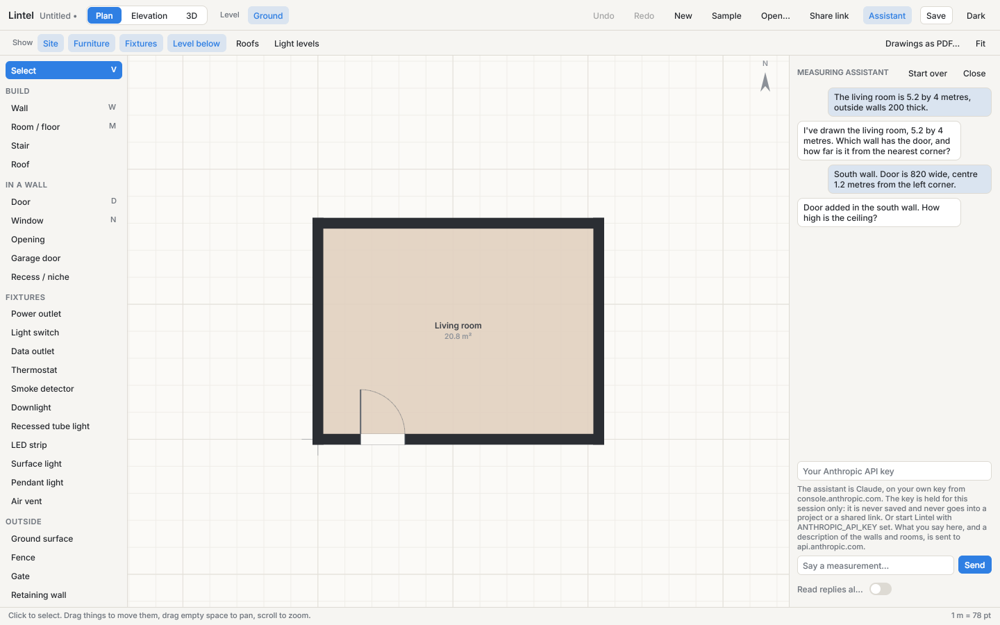

It is Claude (`claude-opus-5-5`) on **your own Anthropic API key**, from console.anthropic.com.
Type the key into the panel, or start Lintel with `ANTHROPIC_API_KEY` set. The key is held in
memory for the session: it is never written to disk, a project file or a shared link. What you
say, and a description of the walls and rooms on the level you're working on, goes from your
computer straight to api.anthropic.com and nowhere else; usage is billed to your key.

Speech: Lintel doesn't listen to the microphone itself. Click in the box and use the
computer's own dictation (macOS: the microphone key or Fn twice; Windows: Win + H), then press
Enter. **Speak replies** reads the answers aloud with the system voice (`say` on macOS, Windows
speech, `spd-say` or `espeak` on Linux). The assistant can add and change walls, doors,
windows, openings, garage doors, rooms and level heights; finishes, fixtures and furniture are
still placed by hand. It has been tested against recorded API responses, not yet against the
live service.

## Drawings

**Drawings as PDF…** (plan view) writes the set, one landscape page each. First a dimensioned
plan of every level: walls, doors and windows, room names with areas and sizes, stairs,
fixtures, a chain of dimensions between the walls with an overall figure, a north arrow and a
scale bar. Then an elevation of each face, south, east, north and west: the building in flat
tones, the ground as it meets that face, each floor level with its height, and the overall
width and height. Choose A4, A3, Letter or Tabloid and a standard scale under **Drawings** in
the project panel, or leave the scale on best fit.

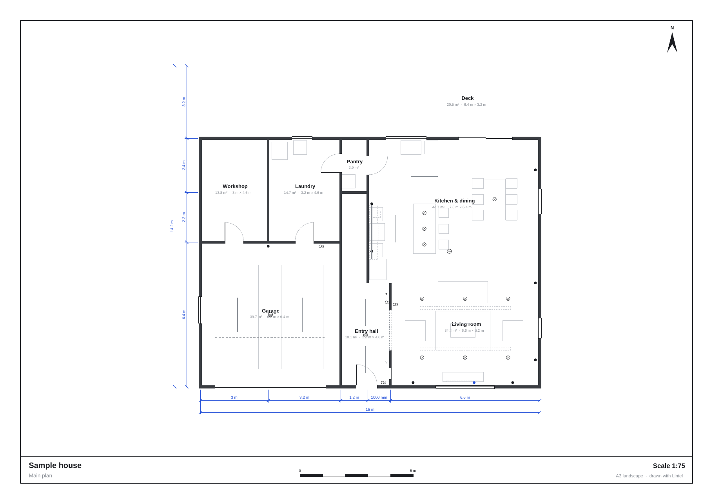

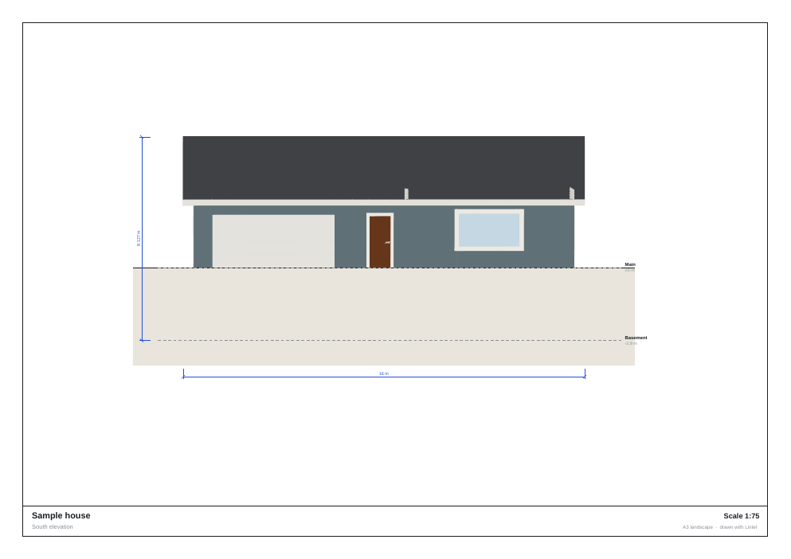

## Pictures and 3D export

In the 3D and elevation views, **Save picture…** writes the view as a PNG at the window's
full resolution, without the panels. **Export 3D…** writes the whole house as a single glTF
file that opens in Blender and most 3D software; colours travel with it, Lintel's procedural
grain and tile patterns don't.

## Share a house as a link

**Share link** copies an address that opens the house in a browser, on a phone too. The
project travels inside the link itself, compressed (the sample house is about 9 000
characters), so nothing is uploaded and there is no account. A narrow screen gets a viewer:
plan, side and 3D views, levels, and lifting the roof off, without the editing panels.

The page also opens a project file from an address:
`https://bendechrai.github.io/lintel/app/?project=<url of a .lintel.json>` (the host must allow
cross-origin reads, as a raw GitHub or gist link does).

The browser needs WebGPU (recent Chrome, Edge and Safari). To build the page yourself:

```bash
scripts/web-build.sh
```

```bash
python3 -m http.server 8000 -d target/web
```

That serves the landing page (`site/`) at the root and the app under `app/`. In headless Chromium the page loads linked and fetched projects and draws every view with no
GPU errors. Saving, opening files and the elevation fetch don't work in the browser yet.

## Not yet

L- and U-shaped stairs, dormers and valleys, wall editing in 3D, sections in the PDF,
textures from photos, a phone room-scan import, signed installers. The assistant doesn't
listen to the microphone itself, and isn't in the browser version.

MIT.
